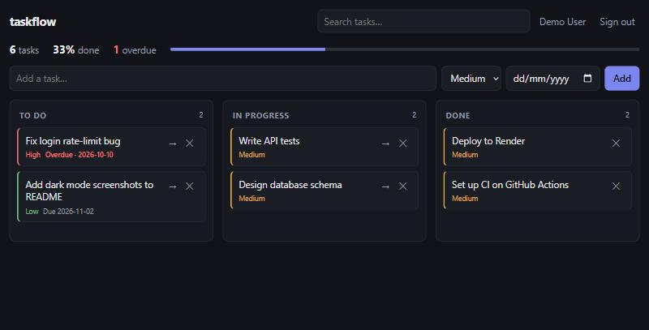

# taskflow

**A full-stack Kanban task manager: React + TypeScript frontend, Express + SQLite REST API, JWT auth, drag-and-drop ordering, and a one-container deploy.**




## Features

- **Accounts:** register and sign in with email and password (scrypt hashes, HS256 JWT). Every task query is scoped to the signed-in user.
- **Kanban board:** three columns, native HTML5 drag-and-drop between and within columns, plus a one-click "move forward" button that also works on touch devices.
- **Fast reordering:** fractional positions mean a drop updates **one row**, not the whole column.
- **Optimistic UI:** moves and deletes render instantly and roll back if the API rejects them.
- **Search and stats:** debounced full-text search, completion rate, and an overdue counter.
- **Responsive, light and dark:** a single CSS file with design tokens and no UI framework.
- **Mobile client:** a Flutter app for Android and iOS consumes the same API ([taskflow-mobile](https://github.com/affifariza04/taskflow-mobile)).

## Architecture

```
web/  (Vite + React)                server/  (Express 5)
┌──────────────────────┐   /api    ┌──────────────────────────────────────────┐
│ App ── api.ts (fetch)│ ────────▶ │ json limit · security headers            │
│  ├─ AuthForm         │           │ /api/auth   rate-limit → zod → scrypt/JWT │
│  ├─ NewTask          │           │ /api/tasks  requireAuth → zod → SQL       │
│  └─ Board (DnD)      │           │ errorHandler → { error: { code, ... } }  │
└──────────────────────┘           └───────────────┬──────────────────────────┘
                                                   ▼
                                    node:sqlite (WAL, FK, versioned migrations)
```

In production the API server also serves `web/dist` with an SPA fallback, so the whole app ships as one process and one Docker image.

## API

| Method | Path | Notes |
|---|---|---|
| `POST` | `/api/auth/register` | `{ email, name, password }` → `{ token, user }` |
| `POST` | `/api/auth/login` | Same error for unknown email and wrong password |
| `GET` | `/api/auth/me` | Requires a Bearer token |
| `GET` | `/api/tasks?status=&priority=&q=` | Ordered by column, then position |
| `POST` | `/api/tasks` | `{ title, description?, status?, priority?, dueDate? }` |
| `PATCH` | `/api/tasks/:id` | Any subset of fields, including `position` |
| `DELETE` | `/api/tasks/:id` | `204` |
| `GET` | `/api/tasks/stats` | `{ total, byStatus, overdue, completionRate }` |

Browser clients on another origin (for example the Flutter web build) need `CORS_ORIGINS=https://app.example.com`. CORS is off by default, and native mobile apps don't need it.

Every error has the same shape: `{ "error": { "code": "validation_error", "message": "...", "issues": [{ "path": "email", "message": "..." }] } }`.

## Run it

Requires Node 22.13+ (it uses the built-in `node:sqlite`, so there are no native modules to compile).

```bash
git clone https://github.com/affifariza04/taskflow && cd taskflow
npm install
npm run dev          # API on :3001, web on :5173 (proxied)
```

Production with Docker:

```bash
docker build -t taskflow .
docker run -p 3001:3001 -e JWT_SECRET="$(openssl rand -hex 32)" -v taskflow-data:/app/server/data taskflow
```

## Tests

```bash
npm test             # 16 API tests (supertest, in-memory DB) + 7 board-logic tests
npm run typecheck
```

The API tests cover the security-relevant paths, not only the happy ones:

- one user cannot read, edit, or delete another user's tasks (returns `404`, not `403`, so IDs don't leak)
- no account enumeration through login errors
- rate limiting on auth endpoints (`429` with `Retry-After`)
- `LIKE` wildcards in search are escaped (`q=%` doesn't match everything)
- validation of every input, plus malformed-JSON handling

The app was also tested by hand in the browser: register, create, move, drag-and-drop reorder, reload persistence, and the mobile layout.

## Design decisions

- **SQLite via `node:sqlite`:** no ORM and no native build step. The schema is small enough that plain SQL with `RETURNING` stays readable, and versioned migrations live in [`server/src/db.ts`](server/src/db.ts).
- **Fractional indexing** instead of renumbering on every drag. If positions ever get too close together, a background job could rebalance a column. That isn't needed at this scale.
- **Tokens in `localStorage`** keep the demo simple. For a production app with third-party scripts, I'd move to an `httpOnly` session cookie with CSRF protection.

## Roadmap

- Multiple boards and sharing a board with teammates
- Keyboard-accessible reordering (drag-and-drop is mouse-only today)
- Postgres adapter for multi-instance deploys
- Playwright end-to-end tests in CI

MIT licensed.
